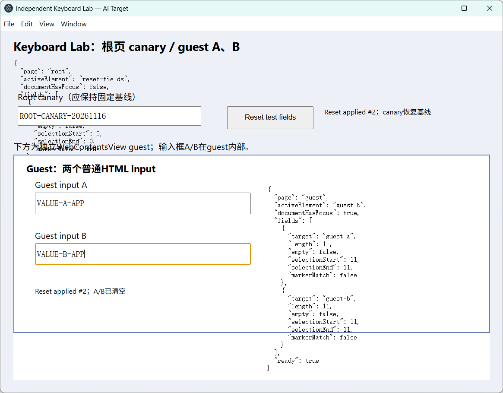
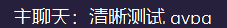
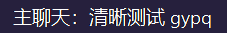

# Verification and limits

## Reproduce without desktop input

Windows 10/11, Windows PowerShell 5.1 and Node.js 24 (the SQLite tests use built-in node:sqlite):

```powershell
cd integrations/codex
npm test
```

No npm install is needed. The explicit allowlist is `scripts/verify.mjs`: compact observation/control projections; root sidebar/project identity against temporary SQLite/WAL fixtures; focus policy; cancellation/timeout/EOF with thin transport recorders; fresh Value setter with simulated providers; compiled keyboard/stop/placement methods; actual independent-process Windows mutex/guardian FIFO, cancellation, pause, PID-birth and ready wakeups. Tests use temporary data roots and random internal TestNamespace values. They do not send mouse/keyboard input, show overlay/fixture windows, install a plugin or clear real desktop ownership/pause. CI runs this allowlist on windows-latest; CI is not GUI acceptance.

Expected: every listed process exits 0 with PASS/GREEN. Provider/transport tests are synthetic contracts; actual subprocess/mutex tests exercise the shared Windows control protocol, not an application. The wakeup test creates a copied guardian with a post-release teardown barrier, proving that a still-alive exiting guardian does not delay readiness to the full wait deadline. No production sleeps are added.

The asset test resolves both repository and standalone paths, decodes the original upstream 512x192 atlases, and compiles pure overlay placement methods without Show. It requires no personal cursor metadata. Root DSH entry files and assets are compared byte-for-byte to the upstream baseline during preparation; that is a regression boundary, not an actual DSH Host run.

## Protocol v3 coverage

The Windows suite exercises three independent execution lanes, fourth-request FIFO, native guardian shutdown, dead-executor recovery and retained pause provenance. Shared-header and resume checks exercise projections and receipt readback through isolated seams. Authentication checks exercise public output redaction and screenshot gating with synthetic input. The snapshot fixture initializes the staged MCP entry, deletes its simulated cache, and checks that the runtime and protocol still work. The packaging check builds both native helpers, stages the unchanged upstream artwork, and verifies the manifest-selected MCP entry with isolated temporary state. It also runs the fixed-helper EOF check and launch-ticket ownership check against a temporary process with no window.

## Native capture build (manual prerequisite, no screenshot)

```powershell
cmd /c native\window-capture\build.cmd
native\window-capture\bin\win-x64\dsh-window-capture.exe --probe
```

Requires existing Visual Studio C++ tools and Windows SDK. `--probe` checks capabilities only: no capture/foreground/input. Binaries are generated locally and ignored in Git. WGC capture itself needs an explicitly authorized GUI test and is not run by npm test/CI. Standard system capture borders are not disabled.

## Previously obtained live evidence (redacted)

On Windows with Node 24 and Codex Desktop, the local 0.6.0 runtime reported control protocol 2. With a real holder and two real queued executions, normal finish woke the first waiter; a fresh begin obtained a new lease; only that hold's first eligible tool reply contained the queue reminder. Two following status replies contained no duplicate. After finish the second pending waiter became ready and cancelled its own ticket without application input. Tool delivery does not prove that a model read a reminder.

The same authorized executor used fresh observed elements in an owned Electron WebContentsView fixture. Four explicit mode:value writes (replace/append for two fields) returned exact value-readback-only verification; final visual inspection showed the expected values and an unchanged root canary. Fixture logs showed input and DOM focus events. Those results cover that fixture only, not all frameworks, IME or arbitrary applications. This evidence predates this source-only layout and the upstream-asset fallback; it is not claimed as a new GUI run of this PR checkout. Only the owned fixture screenshot below is published; no private desktop, transcript, conversation ID, project name, profile or raw log is published.

System foreground was sampled only before/after; no continuous recorder ran in that final round. Unchanged human text does not prove foreground preservation. Game focus, arbitrary-app focus preservation, a specific business app's new Value path, and native DSH Host behavior remain unverified. No claim of full native-input equivalence is made. The final live executor finished normally and released its own lease. Codex was not closed or restarted.

## Relationship to existing upstream work

Open PRs #3 and #4 address the original DSH tool-schema contract; #4 also improves text handling. This PR does not incorporate their unmerged changes or claim those fixes exclusively. Its Codex adapter exports a standard MCP object schema while leaving the DSH entry unchanged. A future shared-core extraction needs a separately verified DSH identity/lifecycle contract.


### Owned fixture visual evidence



The authorized capture shows only the owned fixture and public test markers. A and B display `VALUE-A-APP` / `VALUE-B-APP`, while the root canary remains unchanged. The fixture's generic markerMatch flags refer to its separate original test-marker configuration and are not the Value readback verifier. This image proves neither focus preservation nor every framework's state/event handling.

### Selected live queue fields (redacted projection)

These are selected non-identity fields from three preserved formal MCP replies, not complete raw responses. IDs, names, projects and leases are omitted. The parent's earlier observation summary placed its ticket at position 2 behind sequence 1; that first-position statement is a summary, not an archived raw body.

```json
{
  "waiting": {"ok":true,"state":"busy","turn":"queued","position":1,"canAcquire":false,"waitResult":"timeout","reminderStatus":"delivered-to-tool","queue":[{"position":1,"sequence":2}]},
  "ready": {"ok":true,"state":"available","turn":"ready","position":1,"canAcquire":true,"waitResult":"ready","queue":[{"position":1,"sequence":2}]},
  "cancelled": {"ok":true,"state":"available","turn":"not-queued","position":0,"canAcquire":true,"queue":[]}
}
```

The single-holder reminder/no-repeat behavior was reported by the actual executor (two later status responses); no preserved full raw body is claimed for those two reports. `delivered-to-tool` is delivery metadata, not proof of model attention. No direct message was sent to the other holder.


## 0.6.1 stop-gesture change (method tests only)

The plugin now accepts physical **Ctrl+Esc** only while active and not already paused. Either Ctrl is accepted; Shift, Alt or either Win key excludes the gesture (in particular Ctrl+Shift+Esc is untouched). Plain Esc, Ctrl itself, injected Esc, idle and newly pressed paused gestures pass through. Only a successfully recorded stop captures that Esc's down/repeats and matching up; a fresh active lifecycle clears any stale capture. The compatible Ctrl+Alt+Q path is unchanged. The application-level `key:escape` parser and host/official-CU cancellation flags are unchanged; real host-ended/refusal must still stop input.

New stops carry `reason:control-escape`, `source:keyboard-hook` and `keyboard.gesture:Ctrl+Esc` with modifier/trigger metadata. Old `escape` records retain their original Esc interpretation. The compiled production helper is tested with explicit modifier states, without installing a hook or sending real keys. This establishes the filtering/paired-release contract, not actual Windows Start-menu suppression or host behavior under physical keys. Those GUI effects are not claimed as tested here. Historical 0.6.0 CI/live results above remain historical.

The MCP cancellation test now uses bounded protocol conditions instead of a fixed 2500ms cleanup sleep or a 5-second speed assertion: status must return while the original wait remains pending, cancellation must wake that wait without timeout, and the cancelled ticket must disappear without pausing the holder. Each condition has a 30-second deadline and the case has a 120-second overall deadline. This is test synchronization only; the queue core is unchanged.


## 0.6.2 tooltip glyph clipping

The tooltip previously fixed its outer height to 28px, leaving 20px after its existing vertical padding. For a 9pt Segoe UI font in a 144-DPI GDI DC, its measured line height exceeds that area (equivalent to 13.5pt in a 96-DPI replay DC). The production OnPaint lost 40–300 foreground glyph pixels across the sampled text cases, and 343–1127 in the normalized 192-DPI replay. Switching only measurement flags did not cure it. Measuring height plus the original 8px padding does; width remains bounded to 110–420px and the same ellipsis, font, caption and screen-edge placement are kept.




These are offscreen bitmap outputs with synthetic Chinese/descender text, not a screenshot of a real chat or cursor. The PowerShell test is UTF-8 BOM and asserts the Chinese sample's codepoints; an early no-BOM diagnostic script was misdecoded by Windows PowerShell and discarded as invalid evidence. That was a harness encoding mistake, not a product text-encoding diagnosis.

`test/tooltip-render-test.ps1` compiles the full shipped C#, invokes actual SessionTip measurement/OnPaint, and compares the bounded bitmap's glyph mask with an unclipped reference. It covers four font/DPI inputs, Chinese, mixed descenders, long ellipsized names, plus an unchanged-caption FontChanged lifecycle (20 cases). Merely changing bitmap SetResolution does not scale GDI TextRenderer, so the test initializes the production DPI context and normalizes the Font against the actual GDI DC DPI before replaying 96/120/144/192 inputs; it does not claim a real monitor transition. The frozen old sizing/OnPaint path goes RED; new production goes GREEN with no missing mask pixels. Removing the new event reflow in a diagnostic-only memory probe makes the unchanged-caption lifecycle RED.

Display prepares managed size and target-clamped location before Show, then remeasures after Show; FontChanged/DpiChanged share guarded local relayout. A hidden offscreen instance updates only managed bounds and keeps IsHandleCreated=false; the test checks its actual pre-Show bounds against the existing screen-edge clamp. A visible tooltip retains the original workarea positioning and NOACTIVATE flags. No hook, Show, input, settings or real owner is touched by the test. Actual first-show/monitor GUI behavior remains unverified here; this is renderer/lifecycle regression evidence. Historical 0.6.0/0.6.1 live/CI evidence above is not relabelled as 0.6.2 acceptance. `npm test` adds this one no-GUI test to the existing allowlist.
